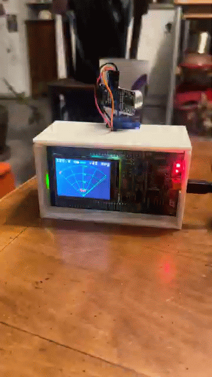

# Mini-Sonar

A real-time ultrasonic radar running on the **STM32F429I-DISCO** board. A servo sweeps an HC-SR04 sensor across 90° while the onboard LCD shows the scan line, detected obstacles, distance, and angle.

<p align="center">
  
</p>

## How it works

1. The servo moves through 101 positions, from 1000 µs to 2000 µs and back.
2. At each position, the firmware waits 60 ms, then triggers a distance measurement.
3. The radar moves its green scan line to the current angle.
4. An echo between 2 and 100 cm is drawn as a red dot. The dot stays until the scan line returns to that angle.
5. The onboard green LED (PG13) turns on when an object is within 30 cm.

## Hardware

| Component | Signal | STM32 pin | Peripheral |
|---|---|---|---|
| Servo | PWM | PB7 | TIM4_CH2 |
| HC-SR04 | Trigger | PB4 | GPIO output |
| HC-SR04 | Echo | PB3 | TIM2_CH2 input capture |
| Onboard LED | Proximity indicator | PG13 | GPIO output |
| Onboard LCD | Display | Board wiring | LTDC, SPI5, FMC SDRAM |

The servo, sensor, and board must share a common ground. PB6 cannot be used for the servo because the onboard SDRAM uses it.

## Bare metal and HAL

The project deliberately uses two levels of abstraction.

### Bare metal: servo and HC-SR04

These drivers access the CMSIS registers directly, with no HAL calls:

- **Servo:** TIM4 runs at 1 MHz with a 20 ms period (50 Hz). `CCR2` sets the pulse width directly in microseconds.
- **HC-SR04:** PB4 sends a 10 µs trigger pulse. TIM2 captures the rising and falling edges of the echo on PB3 with 1 µs resolution, then `distance_cm = echo_us / 58`. A 30 ms timeout handles missing echoes.
- **LED:** PG13 is driven through the GPIO registers.

### HAL: LCD

The display needs several coordinated peripherals, so STM32CubeMX generates their setup:

- **FMC** drives the external SDRAM that stores the framebuffer.
- **LTDC** continuously sends the framebuffer to the LCD.
- **SPI5** sends configuration commands to the ILI9341 controller.

CubeMX does not initialize the SDRAM chip or the ILI9341, so `src/display.c` adds both startup sequences. The CubeMX `main.c` is not compiled: `src/main.c` remains the entry point and calls only the generated init functions it needs.

The system runs at **180 MHz**, as required by the SDRAM timing. APB1 timers run at 90 MHz, so TIM2 and TIM4 use a prescaler of 89 to get 1 MHz.

## Project structure

| Path | Role |
|---|---|
| `src/main.c` | Entry point, LED control, and main scan loop |
| `src/servo.c` | Bare-metal servo PWM driver |
| `src/hcsr04.c` | Bare-metal ultrasonic sensor driver |
| `src/radar.c` | Radar grid, scan line, obstacles, and text |
| `src/display.c` | LCD startup, framebuffer, landscape text drawing |
| `src/system_clock.c` | 180 MHz clock setup and HAL error handler |
| `include/*.h` | Public headers for the modules above |
| `src/gpio.c`, `src/timer.c`, `include/gpio.h`, `include/timer.h` | Empty placeholders, not compiled |
| `cubeMX/cubeMX.ioc` | CubeMX project configuration |
| `cubeMX/Core/` | Generated peripheral setup, interrupts, and HAL config |
| `cubeMX/Drivers/` | HAL and CMSIS used by the build |
| `Utilities/Fonts/` | Bitmap fonts (the build uses 12 px and 24 px) |
| `startup/startup_stm32F429I.s` | Vector table and reset handler |
| `linker/linker.ld` | Flash and RAM memory layout |
| `Makefile` | Firmware build |
| `Drivers/` | Earlier vendor drivers, not used by the build |
| `docs/images/demo.gif` | Project demo |

## Build and flash

Requirements: `arm-none-eabi-gcc`, `make`, and `stlink-tools`.

```sh
make clean && make
arm-none-eabi-objcopy -O binary build/sonar.elf build/sonar.bin
st-flash --reset write build/sonar.bin 0x08000000
```

Run `make clean` after changing a header, because the Makefile does not track header dependencies.

## Configuration

| Setting | File | Default | Purpose |
|---|---|---|---|
| `RADAR_RANGE_CM` | `src/radar.c` | `100.0f` | Maximum distance drawn |
| `RADAR_HALF_ANGLE_DEG` | `src/radar.c` | `45` | Half of the displayed sweep |
| `RADAR_DIRECTION` | `src/radar.c` | `1` | Use `-1` to mirror the sweep |
| `DISPLAY_LANDSCAPE_FLIP` | `include/display.h` | `1` | Use `0` to rotate the image by 180° |
